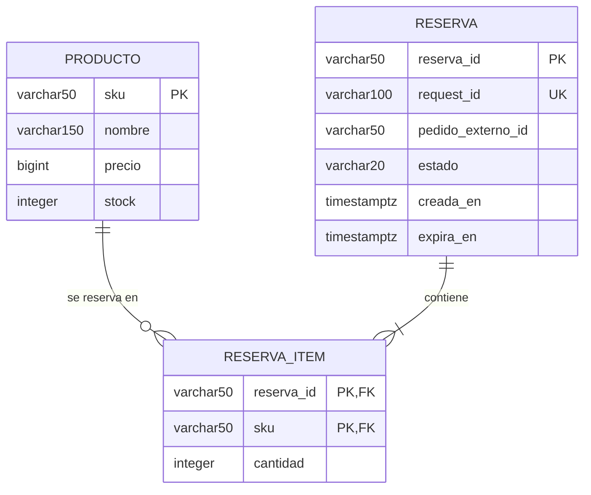

# Base de datos de SuperMax: estado real y propuesta para reservas

Revisión del 03/10/2026. Se consultó directamente PostgreSQL en modo de solo lectura usando la conexión de `Bd.java`: `localhost:5432`, base `supermax`. Motor: PostgreSQL 18.4.

Actualización del 16/10/2026: se volvió a consultar el esquema en modo de solo lectura; continúa existiendo únicamente `producto`, con las mismas columnas y restricciones y tres filas. Las tablas propuestas siguen pendientes de aplicar. Para el reparto definitivo de servicios, reintentos, vencimiento y orden de bloqueos, consultar [estado y acuerdos compartidos](Estado_actual.md) y sus dos handoffs.

## Estructura existente verificada

La única tabla de usuario encontrada es **public.producto** (singular). No existen todavía `reserva` ni `reserva_item`.

| Columna | Tipo real | Nulos | Regla |
| --- | --- | --- | --- |
| sku | VARCHAR(50) | No | Clave primaria `pk_sku`. |
| nombre | VARCHAR(150) | No | Obligatorio. |
| precio | BIGINT | No | `ck_precio_positivo`: precio >= 0; admite cero. |
| stock | INTEGER | No | `ck_stock_no_negativo`: stock >= 0. |

No hay valores por defecto en estas columnas. El índice existente es el B-tree único de la clave primaria `pk_sku`. La tabla tiene tres filas; no se encontraron precios ni stocks negativos.

La definición SQL equivalente está en [`../db/001_producto.sql`](../db/001_producto.sql). Está destinada a inicializar una base vacía: no debe aplicarse de nuevo sobre la tabla local existente.

## Propuesta mínima para RESERVAR_STOCK

Mantener `producto` y agregar dos tablas. El SQL propuesto está en [`../db/002_reservas_propuesta.sql`](../db/002_reservas_propuesta.sql); **no se aplicó** a PostgreSQL.

### reserva

| Columna | Tipo propuesto | Propósito |
| --- | --- | --- |
| reserva_id | VARCHAR(50), PK | Identificador generado por Java, por ejemplo `RES-` más un UUID. |
| request_id | VARCHAR(100), UNIQUE, NOT NULL | Reconocer un reintento de la misma solicitud sin reservar dos veces. |
| pedido_externo_id | VARCHAR(50), NOT NULL | Referencia al pedido de EntregaYa; no es una FK a otra base. |
| estado | VARCHAR(20), NOT NULL | `RESERVADA`, `CONFIRMADA`, `LIBERADA` o `EXPIRADA`; inicial `RESERVADA`. |
| creada_en | TIMESTAMPTZ, NOT NULL | Fecha de creación; valor por defecto `CURRENT_TIMESTAMP`. |
| expira_en | TIMESTAMPTZ, NOT NULL | Vencimiento persistente, posterior a la creación. El servicio calcula inicialmente 300 segundos, según el ejemplo del contrato. |

Las longitudes de los identificadores son decisiones propuestas para el MVP; los contratos no fijan esos límites. El servicio deberá validarlos. No se impone unicidad de `pedido_externo_id`: una solicitud nueva puede crear otra reserva para un pedido cuya reserva anterior haya vencido. Una regla de una sola reserva activa por pedido debe definirse si luego se necesita.

Guardar `request_id` es una decisión de persistencia para reintentos TCP, aunque el campo nace como metadato del protocolo. La restricción UNIQUE por sí sola no implementa idempotencia: Java debe devolver la reserva existente cuando la solicitud repetida tiene el mismo contenido y rechazar la reutilización del identificador con otro pedido o conjunto de items. No se debe renovar el vencimiento ni volver a reservar stock al repetir la solicitud.

### reserva_item

| Columna | Tipo propuesto | Propósito |
| --- | --- | --- |
| reserva_id | VARCHAR(50), FK | Reserva a la que pertenece el item. |
| sku | VARCHAR(50), FK | Producto reservado; mismo tipo y longitud que la columna real. |
| cantidad | INTEGER, NOT NULL, CHECK > 0 | Unidades reservadas de ese producto. |

La clave primaria es **(reserva_id, sku)**: un producto aparece una vez en cada reserva. Para este MVP, Java rechazará SKUs repetidos con SOLICITUD_INVALIDA. El índice adicional por `sku` ayuda a calcular reservas de un producto. Las FKs impiden items sin reserva o sin producto. Se usa la conducta predeterminada de las FKs para evitar borrar accidentalmente productos o reservas referenciados.

Una reserva válida debe tener al menos un item: el servicio valida que `items` no esté vacío y crea cabecera e items en una sola transacción. Una FK sola no garantiza que toda cabecera tenga items.

## Regla de stock propuesta

Para respetar el contrato de confirmar/liberar, **producto.stock representa existencias físicas**. Crear una reserva no modifica ese campo. Las unidades disponibles se calculan restando las cantidades de reservas con estado `RESERVADA` y vencimiento futuro:

`disponible = producto.stock - unidades en reservas activas no vencidas`

Ejemplo: si hay 10 unidades físicas y una reserva activa por 3, hay 7 disponibles. Al confirmar esa reserva, el stock físico pasa a 7 y la reserva pasa a `CONFIRMADA`; la disponibilidad sigue siendo 7. Al liberar o vencer la reserva sin confirmar, el stock físico continúa en 10 y las 3 unidades dejan de bloquear la disponibilidad.

| Operación | Reserva | producto.stock |
| --- | --- | --- |
| Reservar | Crear `RESERVADA` e items. | No cambia. |
| Confirmar antes del vencimiento | Cambiar a `CONFIRMADA`. | Descontar cantidades una sola vez. |
| Liberar | Cambiar a `LIBERADA` si aún está reservada. | No cambia. |
| Vencer | Dejar de contar como activa; puede marcarse `EXPIRADA`. | No cambia. |

El vencimiento no ocurre automáticamente por tener una columna de fecha. Para el MVP alcanza con excluir reservas vencidas al calcular disponibilidad y rechazar su confirmación; el servicio puede marcar `EXPIRADA` cuando las consulta. No hace falta un proceso periódico para que las unidades vuelvan a estar disponibles con esta estrategia.

**Impacto en GET_CATALOGO:** al incorporar reservas, el `stock` enviado al cliente debe ser la disponibilidad calculada, en lugar de leer directamente el stock físico como hace hoy `ProductoDAO`. El nombre del campo JSON se conserva.

## Transacciones necesarias en Java

1. Validar `pedidoExternoId`, `requestId` e items: cantidades enteras positivas, SKUs existentes y lista no vacía.
2. Abrir una transacción JDBC. Bloquear con `SELECT ... FOR UPDATE` las filas de los productos involucrados, siempre en orden de SKU para reducir deadlocks.
3. Después de adquirir los bloqueos, consultar la disponibilidad con una nueva sentencia bajo `READ COMMITTED` y comprobar todos los items. Si falta stock para alguno, hacer rollback sin crear una reserva parcial.
4. Insertar la reserva y todos sus items, y hacer commit. Manejar un conflicto de `request_id` como reintento, consultando la reserva original después del rollback.
5. Para confirmar, también usar transacción y bloqueos: validar el estado y vencimiento y descontar stock junto con el cambio a `CONFIRMADA`. Solo una transición desde `RESERVADA` puede efectuar ese descuento. Toda operación que descuente stock debe seguir el mismo protocolo de bloqueo de productos.

El orden acordado es productos en orden de SKU y después la cabecera de reserva existente. Confirmar/liberar identifica primero los SKUs sin bloquear, bloquea productos y luego reserva; relee el estado y obtiene la hora de PostgreSQL después de esperar los bloqueos. Ver el detalle en [los acuerdos compartidos](Estado_actual.md). Los CHECK de stock/cantidad no reemplazan la comprobación de disponibilidad ni el control de concurrencia.

## Alcance del MVP y validación

Estas dos tablas cubren reservas de varios productos, vencimiento y el posterior servicio de confirmar/liberar. No se agregan tablas de inventario, catálogo, alertas o pedidos de EntregaYa.

Se verificó la estructura y las restricciones existentes mediante `psql` y consultas de catálogo, en modo de solo lectura. Los scripts nuevos son propuestas locales: no se ejecutó DDL, no se cambiaron datos y todavía falta validar el servicio y las transacciones mediante pruebas de integración cuando se implementen.

Referencias: [contratos v3](SuperMax_v3.md), [restricciones de PostgreSQL](https://www.postgresql.org/docs/current/ddl-constraints.html) y [bloqueos de filas](https://www.postgresql.org/docs/current/explicit-locking.html).
